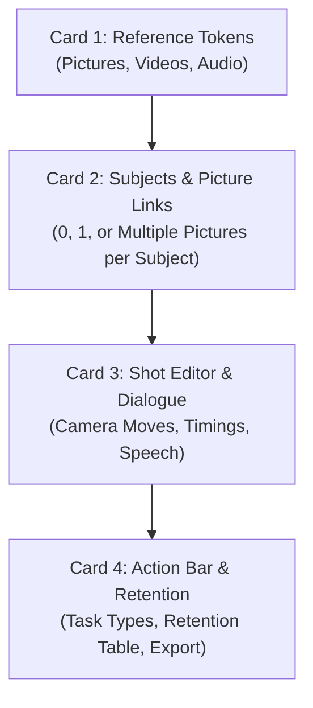

# H3 Prompt Studio — Comprehensive User Guide

> **Normative Reference:** [`docs/specifications/specification-0.3.md`](docs/specifications/specification-0.3.md) §11.2  
> **Target Audience:** Prompt Engineers, AI Filmmakers, VFX Artists, and Technical Directors working with **MiniMax Hailuo 02** (`MiniMax-H3` & `MiniMax-H3-Max`).

---

# Part 1: Novice Walkthrough

## 1. First Launch & Studio Setup

### 1.1 Connecting to Ollama
When you first start H3 Prompt Studio, navigate to the **Settings** tab in the top navigation bar.
1. **Ollama Endpoint:** Verify the endpoint URL is set to `http://127.0.0.1:11434`.
2. **Drafter Model:** Select your installed local LLM (recommended: `qwen2.5:7b-instruct`). Click **[Test Connection]** to fetch all locally pulled models from Ollama. If no models appear, open a terminal and pull the recommended drafter:
   ```bash
   ollama pull qwen2.5:7b-instruct
   ```
3. **Model Inspector:** Selecting a model displays its metadata: parameter size (e.g., `7.6B`), quantization (`Q4_K_M`), family (`qwen2`), and active context window (`8192` tokens).

### 1.2 Video Foundation Model Selection
H3 Prompt Studio supports two video foundation models with strict parameter rules:
- **`MiniMax-H3`:**
  - Allowed Durations: `4` to `15` seconds (default: `8s`).
  - Allowed Resolutions: `768P` (Fast/Draft) and `2K` (Production).
  - Use case: High-definition cinematic shorts, fluid camera choreography, and multi-shot narrative scenes.
- **`MiniMax-H3-Max`:**
  - Allowed Durations: `5` to `15` seconds (default: `10s`).
  - Allowed Resolutions: `480P` and `768P`.
  - Use case: Complex physical simulations, intricate multi-character choreography, and maximum visual fidelity.

> [!NOTE]
> Switching models automatically clamps the duration slider and resolution dropdown to valid ranges and notifies you immediately. The local LLM drafter does not alter these limits.

### 1.3 Nord Theme Switcher
Choose between three handcrafted Nord color palettes directly in Settings without page reload:
- **Nord Dark (Default):** High-contrast polar dark theme (`nord0`–`nord3`) designed for color grading and darkroom environments.
- **Nord Coloured:** Vibrant accenting using the Aurora palette (`nord7` frost cyan, `nord8` ice blue, `nord14` aurora green).
- **Nord Light:** Clean, bright polar snow palette (`nord4`–`nord6`) for daytime work.

---

## 2. Text-to-Video-Audio (T2VA) Mode

T2VA generates a complete cinematic sequence from a single text seed.

### Step-by-Step Workflow:
1. Under the **Generator** tab, click **T2VA**.
2. **Clip Configuration:**
   - **Clip Name:** Enter a recognizable scene name (e.g., `Alleyway Confrontation`).
   - **Duration:** Set between 4s and 15s using the slider.
   - **Aspect Ratio:** Choose a concrete ratio (`16:9`, `21:9`, `4:3`, `1:1`, `3:4`, or `9:16`). *T2VA never allows "adaptive" aspect ratio.*
   - **Visual Style:** Choose **Plain** (with an approved opening like `Live-action, cinematic` or `1970s film stock`) or select one of the 10 **Named Styles** (e.g., `Neo-noir thriller`, `Anime feature film`, `Hyper-realistic documentary`).
3. **Seed & Action Narrative:**
   - Write a 1–2 sentence description of the scene's core conflict or action:
     > *"A trench-coated detective corners a suspect in a rainy, neon-lit alleyway."*
4. **Dialogue Lines (Verbatim & Indic Scripts):**
   - Click **+ Add Dialogue Line**.
   - **Speaker:** Enter `Detective` and select pronoun `his`.
   - **Voice:** Choose from 23 library voices (e.g., `M1 - Deep, measured baritone`) or enter custom voice prose.
   - **Language:** Select from 8 supported languages (`English`, `Kannada`, `Hindi`, `Tamil`, `Telugu`, `Malayalam`, `Marathi`, `Bengali`).
   - **Delivery:** Select delivery tone (e.g., `whisper`, `command`, `deadpan`, `menacing`).
   - **Native Script Text:** Type the exact utterance. Non-English dialogue **must** be written in native script (e.g., `ನಿಲ್ಲು, ಅಲ್ಲಿಯೇ ಇರು.` for Kannada or `रुक जाओ, वहीं रहो.` for Hindi).
5. **Generation & Verification:**
   - Click **Generate Prompt**. The studio streams progress in real time.
   - Review the generated prompt in the preview pane. Monospace syntax coloring highlights shots, camera moves, and expanded dialogue spans.

---

## 3. Frame Reference Modes: I2VA, FL2VA, and L2VA

Frame modes ground your video in keyframe image references. In all frame modes, **Aspect Ratio is strictly locked to `adaptive`**, matching the source image dimensions.

### 3.1 I2VA (Image-to-Video-Audio)
- **Concept:** Animates forward from a starting reference picture.
- **Reference Count:** Exactly **1 image** (`<Picture 1>`).
- **Instruction Line:** The studio automatically generates line 1:
  ```text
  For the target video, at 0.00 seconds into the target video, <Picture 1> (from [Shot 1]) is fully referenced.
  ```

### 3.2 FL2VA (First-Last-Frame-to-Video-Audio)
- **Concept:** Seamlessly interpolates action between a starting frame (`Picture 1`) and an ending frame (`Picture 2`).
- **Reference Count:** Exactly **2 images**.
- **Instruction Line:** Formatted without angle brackets per specification:
  ```text
  How the reference pictures align with the target video — Picture 1 (from Shot 1) aligns with the 0.00-second mark of the target video; Picture 2 (from Shot 2) aligns with the 8.00-second mark of the target video.
  ```
- **Single-Shot Exception (Criterion A-12):** FL2VA uniquely allows a **1-shot camera journey** (e.g. an 8-second continuous tracking shot landing on Picture 2). This waives the normal multi-shot requirement.

### 3.3 L2VA (Last-Frame / Video Continuation)
- **Concept:** Generates video action that leads up to and terminates exactly on the reference image.
- **Reference Count:** Exactly **1 image** (`<Picture 1>`).
- **Instruction Line:**
  ```text
  How the reference pictures align with the target video — <Picture 1> (from [Shot N]) aligns with the 8.00-second mark of the target video.
  ```

---

## 4. Reading the Preflight Validation Panel

Before any prompt can be exported, H3 Prompt Studio runs it through the **35 Preflight Rules (PF-01 to PF-35)**. The validation panel categorizes rule results into five distinct status states:

| Badge / Status | Meaning | Action Required |
|---|---|---|
| **Green (Pass)** | All structural and heuristic rules satisfied. Zero blocking errors. | Prompt is ready for immediate export. |
| **Red (Fixable)** | One or more structural errors occurred that the LLM or autofix can resolve (e.g., minor timestamp syntax, missing camera capitalization). | Click **Fix Prompt**. The studio executes an automatic repair loop. |
| **Red (Input Required)** | A fundamental constraint is broken (e.g., Romanized Indic text, invalid duration, exceeding reference token budgets, stale prompt). | Fix your inputs (e.g., update duration or convert dialogue to native script) and click **Generate**. The LLM cannot guess your intent. |
| **Yellow (Warning)** | Advisory recommendation (e.g., image aspect ratio slightly tall, detailed description word count 340 words). | Non-blocking. You can export immediately without making changes. |
| **Blue (Overridable)** | A heuristic text rule flagged your prose (e.g., PF-04 camera modifier or PF-05 face orientation), but your phrasing is intentional. | Click **Override**, enter a brief justification note, and submit. The error is cleared for that prompt. |

---

## 5. Exporting Prompts & Collision Handling

1. **Click [Export Clip]:** Opens the atomic export dialog.
2. **Clip Numbering (`NN`):** The studio suggests the next available integer (e.g., `01`, `02`).
3. **Collision Detection on Integer `NN` Alone (§10.1):**
   - The studio checks if any existing file in `data/exports/` matches `clip-<NN>-*` using integer math.
   - For example, if `clip-01-8s.txt` exists, attempting to export clip `1` with a 10s duration (`clip-1-10s.txt`) is flagged as a **Conflict (HTTP 409)**.
   - You can either accept the auto-incremented number (`clip-02-8s.txt`) or check **Overwrite Existing**.
4. **Atomic Write Guarantee:** The studio writes to a hidden temporary file and links/replaces it atomically. A disk error or process crash will never leave a corrupted or partial prompt file.
5. **Rollback Snapshot:** Every successful export creates an immutable JSON snapshot in `data/backups/clip-<id>-<timestamp>.json` containing the full database state. The studio automatically retains the last 5 snapshots per clip.

---

# Part 2: Advanced Guide

## 6. REF2VA Flat Single-Canvas Interface

REF2VA is the flagship mode for complex cinematic sequences requiring visual consistency across characters, outfits, camera angles, and vocal timbres.

In H3 Prompt Studio, REF2VA uses a **Flat Single-Canvas Layout** (Criterion A-24). All four cards are visible simultaneously with **zero stepper gating or step locks**:



### 6.1 Reference Token Limits (Hard Budgets)
Under specification rules S-02 and PF-20, reference tokens are strictly bounded:
- **Images (`<Picture N>`):** $\le 9$
- **Videos (`<Video N>`):** $\le 3$
- **Audio files (`<Audio N>`):** $\le 3$
- **Total Files:** $\le 12$
- **Media Durations:** $2000\text{ ms}$ to $15000\text{ ms}$ ($2\text{–}15\text{s}$)

> [!IMPORTANT]
> Uploading a 10th image or a 4th audio file triggers an immediate HTTP 422 `budget_exceeded` error. Image dimensions are optional metadata; dimensions outside 256–5760 px emit non-blocking yellow warnings.

### 6.2 Extensive Subject Taxonomy & Deterministic Formulas (S-03)
Subjects are categorized into 5 semantic groups with specialized deterministic formulas—an LLM is never allowed to invent subject definitions:

```html
<!-- 1. Characters & Beings -->
person · character · animal · creature · dinosaur · monster · beast · robot / android · crowd / group · body part · face · hair

<!-- 2. Objects & Items -->
object · prop · weapon · vehicle · tool · device / tech · instrument · furniture · food · drink

<!-- 3. Apparel & Adornment -->
outfit · accessory · jewelry · footwear · headwear · makeup · tattoo

<!-- 4. Environment & Setting -->
location · architecture · interior · landscape · background · plant / flora

<!-- 5. Atmosphere & Visual Elements -->
weather · lighting · color palette · visual effect · particles · texture · material · pattern · symbol · logo · text · other
```

#### Living Beings & Creatures (Person, Character, Animal, Creature, Dinosaur, Monster, Robot):
- **Case A: Zero Pictures Linked (Text-Only):**
  `<Subject 2> is the informant with his appearance, facial features, build, and complete outfit defined by text alone.`  
  `<Subject 3> is the raven with its appearance, facial features, build, and complete feathers defined by text alone.`
- **Case B: One Picture Linked (Identity Anchor):**
  `<Subject 1> is the detective in <Picture 1> with his face, hair, build, and complete trench coat taken exactly from the reference.`  
  `<Subject 2> is the velociraptor in <Picture 2>, a pack hunter, with its face, hair, build, and complete scales taken exactly from the reference.`
- **Case C: Multiple Pictures Linked (Face + Covering/Outfit Split):**
  `<Subject 1> is the officer with his face, hair, and build taken from <Picture 1> and his complete tactical uniform taken from <Picture 2>.`

#### Inanimate Objects, Props & Weapons (`object`, `prop`, `weapon`, `vehicle`, etc.):
- **With 1 Picture:** `<Subject 4> is the ancient broadsword in <Picture 3>, with its shape, material, color, and distinctive details taken exactly from the reference.`
- **With 0 Pictures:** `<Subject 4> is the ancient broadsword, with its shape, material, color, and distinctive details defined by text alone.`

#### Environments & Locations (`location`, `architecture`, `interior`, etc.):
- **With 1 Picture:** `<Subject 5> is the prison corridor in <Picture 4>, including its walls, floor, cell doors, and layout exactly as shown.`
- **With 0 Pictures:** `<Subject 5> is the prison corridor, including its walls, floor, cell doors, and layout defined by text alone.`

#### Picture Anchors and Timbre References:
- **Composition Anchor:** `<Picture 3> is the composition anchor for [Shot 1], defining the layout.`
- **Voice Timbre Reference:** `<Audio 1> is the voice-timbre reference for <Subject 1> (S1).`

### 6.3 Creating and Editing Subjects (✏️ Edit Drawer)

Each subject defined in Card 2 can be modified at any time without having to delete and re-create it:

```text
┌────────────────────────────────────────────────────────────────────────────────────────┐
│ <Subject 1>  [person]  the officer (a prison guard)  [outfit: tactical vest] [✏️ Edit] [✕] │
├────────────────────────────────────────────────────────────────────────────────────────┤
│ ✏️ Edit <Subject 1>                                              [Cancel] [Save Changes] │
│ Role Type: [dinosaur          ▼]  Role Phrase: [velociraptor                         ] │
│ Pronoun:   [its               ▼]  Outfit Noun: [scales                               ] │
│ Appositive: [an apex pack hunter                                                     ] │
│ Features:   [sharp claws, sickle-shaped foot claws, and amber eyes                   ] │
└────────────────────────────────────────────────────────────────────────────────────────┘
```

1. **Inline Edit Drawer:**
   - Click the **✏️ Edit** button on any subject card to expand its inline drawer.
   - All properties are editable: **Role Type** (from 45+ categorized taxonomy options), **Role Phrase**, **Pronoun** (`his`, `her`, `its`), **Outfit / Covering Noun** (e.g. `uniform`, `scales`, `feathers`), **Appositive** (e.g. `an apex hunter`), and **Features List** (e.g. `sharp horns, leathery wings`).
2. **Instant Live Preview Update:**
   - Clicking **Save Changes** immediately calls `PUT /api/subjects/{id}`, refreshes the subject card, updates the live deterministic compiled definitions box at the top of Card 2 (zero LLM calls), and keeps Card 4 retention synchronization in sync.
3. **Cancel Edits:**
   - Clicking **Cancel** or **✕ Close** collapses the drawer and restores original values without persisting changes.

### 6.4 Card 3: Directing Scene Action & Multi-Subject Choreography (`events`)
Card 3 allows authors to direct the exact physical action and staging that happens in each shot using the **🎬 Action / What happens** input:

```text
┌────────────────────────────────────────────────────────────────────────────────────────┐
│ [Shot 1]  | Start: 00:00.000 | Size: Medium Shot | Angle: Eye Level | Camera Move...   │
├────────────────────────────────────────────────────────────────────────────────────────┤
│ 🎬 Action / What happens:                                                              │
│ [ <Subject 1> sits astride <Subject 2>, gripping the reins as the dinosaur gallops... ] │
└────────────────────────────────────────────────────────────────────────────────────────┘
```

#### Directing Multi-Subject Choreography:
When you have multiple subjects (for example, `<Subject 1>` a warrior and `<Subject 2>` a dinosaur):
1. In the **🎬 Action / What happens** input for `[Shot 1]`, write the exact character interactions:
   > `<Subject 1> sits astride <Subject 2>, gripping the leather reins tightly as the dinosaur charges forward through the thick jungle ferns, kicking up clods of earth.`
2. In `[Shot 2]`, describe the subsequent beat:
   > `<Subject 1> leans forward close to the neck of <Subject 2>, scanning the misty canyon ahead with a determined expression.`

#### How the Engine Executes Your Action:
- **During Generation:** The `shot_writer` stage receives the planned camera move, lens size, and your explicit action beats, weaving them into rich cinematic prose that satisfies MiniMax's face-safety and action-chain rules.
- **During Fallback:** If the LLM is unavailable or fails, `stitch_fallback_prose` automatically integrates your exact action text into the compiled prompt.

---

## 7. Canonical Task Types & Retention Analysis

### 7.1 Task-Type Prefixes
REF2VA prompts must open the `summary:` section with a bracketed prefix joining valid task types with ` + `:
```text
summary:
[reference generation + keyframe completion + audio reference] The target sequence translates the officer's appearance...
```
Allowed task types in canonical order:
1. `reference generation`
2. `keyframe completion`
3. `video editing`
4. `video continuation`
5. `audio reuse`
6. `audio reference`

### 7.2 The Video Editing Prefix
When `video editing` is present among the task types, the summary line **must** open with the exact sentence:
```text
The target video is an edited version of <Video K>.
```
where $K$ is the lowest video ordinal (e.g. `<Video 1>`).

### 7.3 Retention Analysis Table
The `retention_analysis:` section specifies how attributes carry over:
```text
retention_analysis:
<Subject 1> (appears in [Shot 1]): fully_preserved - Facial features and uniform match reference.
<Picture 3> ([Shot 1] composition anchor): fully_preserved - Defines camera framing and layout.
<Audio 1>: reference - Acoustic delivery and timbre match dialogue lines.
```

> [!WARNING]
> Rule PF-22 strictly forbids `(Sx)` speaker tokens inside the `retention_analysis:` section. Never write `<Subject 1> (S1): ...` in this section.

---

## 8. Voice Library, Audio Policies & Dialogue Sentences

### 8.1 The 23 Bundled Voices
H3 Prompt Studio bundles 23 normative voice profiles in `app/resources/voices.json`:
- **Female (F1–F10):** Young adult, mature, deep, bright, whispery, authoritative.
- **Male (M1–M11):** Low baritone, gravelly, energetic, hushed, theatrical, warm.
- **Kids (K1–K2):** Child voices (boy/girl).

### 8.2 The 8-Part Speech Sentence Contract
Every spoken dialogue line expands into an exact 8-part deterministic speech sentence:

$$\text{Speech} = \underbrace{\text{Subject Tag}}_{1} + \underbrace{\text{Speaker Tag}}_{2} + \underbrace{\text{Verb}}_{3} + \underbrace{\text{Voice Phrase}}_{4} + \underbrace{\text{Accent}}_{5} + \underbrace{\text{Delivery}}_{6} + \underbrace{\text{Dialogue Span}}_{7} + \underbrace{\text{Lip Closure}}_{8}$$

**Example Output:**
```text
<Subject 1> (S1) says in the voice timbre referenced from <Audio 1>, in a hushed whisper, <d>[English] Stay where you are.</d>. He closes his lips.
```

### 8.3 Audio Policies
- **`dialogue_only` (Default):** Inserts the mandatory house sentence:
  > *"The audio contains only the spoken dialogue, with no background music, no ambience, and no sound effects."*  
  All sound fields are set to `N/A`.
- **`custom`:** Allows free-form sound design in `overall_soundscape:` and `non_diegetic_music:`. The house sentence is omitted.
- **`silence`:** Pure silent video. Sound fields set to `N/A`. House sentence omitted.

---

## 9. Camera Vocabulary & Face-Safety Rules

### 9.1 The 17 Approved Camera Moves
Only normative camera moves from Appendix A.5 are permitted:
- `The camera holds a static shot`
- `The camera pushes in [onto ...]`
- `The camera pulls out [from ...]`
- `The camera zooms in [onto ...]`
- `The camera zooms out [from ...]`
- `The camera pans left [to reveal ...]`
- `The camera pans right [to reveal ...]`
- `The camera tilts up [toward ...]`
- `The camera tilts down [toward ...]`
- `The camera tracks left / right`
- `The camera cranes up / down`
- `The camera arcs clockwise / counter-clockwise`
- `The camera follows handheld [behind / beside ...]`
- `The camera captures a point-of-view perspective`
- `The camera captures dynamic camera shake`

### 9.2 The Face Heuristic Rule (PF-05)
MiniMax Hailuo requires clear geometric cues to render human faces without uncanny distortion:
- Any shot containing a readable or speaking face **must** explicitly declare:
  1. **Orientation:** `front-facing` or `three-quarter`.
  2. **Expression:** An approved emotional cue (e.g., `expression stern`, `eyes watchful`, `jaw tense`).
  3. **Mouth State:** Explicit lip closure when speaking ceases (`lips closed` or `closes his lips`).

---

## 10. ComfyUI Handoff & PLATES Files

When exporting a REF2VA clip, H3 Prompt Studio creates two companion files in `data/exports/`:
1. **`clip-01-8s.txt`:** The raw prompt file to paste into your ComfyUI Text Node.
2. **`clip-01-PLATES.txt`:** The exact reference plate attachment list for ComfyUI LoadImage / LoadAudio nodes:

```text
<Picture 1>: officer_face.png — identity anchor: Officer portrait
<Picture 2>: officer_uniform.png — outfit: Officer uniform
<Picture 3>: corridor.png — composition anchor: Corridor layout
<Audio 1>: officer_voice.wav — voice_timbre: Officer vocal timbre
```

Each line uses a Unicode em dash (`—` `U+2014`) separating the token filename from its assigned roles and caption. Missing source files are explicitly flagged as `MISSING`.

---

## 11. Preflight Troubleshooting Index (PF-01 to PF-35)

| Rule ID | Name | Cause | Resolution |
|---|---|---|---|
| **PF-01** | Template Integrity | Missing sections, corrupt headers, or trailing whitespace. | Click **Autofix** or verify clean line breaks. |
| **PF-02** | Shot Timestamps | Cut timestamp syntax malformed (e.g. `00:03:000` with colon). | Autofix converts colons to periods (`00:03.000`). |
| **PF-03** | Shot Budgets | Too many or too few shots for the duration. | Check shot duration table (e.g., an 8s clip needs 2–3 shots). |
| **PF-04** | Camera Moves | Non-standard camera verb or missing landing phrase. | Select approved verb from dropdown or override if intentional. |
| **PF-05** | Face Heuristic | Speaking shot lacks `front-facing` or `three-quarter`. | Add face orientation and expression to shot prose. |
| **PF-06** | Speech Expansion | Malformed speech sentence or missing speaker tag `(S1)`. | Let the deterministic renderer assemble dialogue lines. |
| **PF-07** | Dialogue Text | Punctuation or text inside `<d>` does not match `text_raw`. | Ensure dialogue has terminal punctuation (`.`, `?`, `!`). |
| **PF-08b**| Mood Words | Music contains banned abstract adjectives (`tense`, `sad`). | Replace mood words with acoustic instruments or tempo terms. |
| **PF-11** | Ratio Concrete | T2VA set to `adaptive` or frame mode set to `16:9`. | Lock T2VA to a concrete ratio; lock frame modes to `adaptive`. |
| **PF-20** | Reference Budgets | $>9$ images, $>3$ videos, $>3$ audio, or duration $>15\text{s}$. | Delete excess reference tokens in Card 1. |
| **PF-21** | Summary Task Types| Missing bracketed prefix or invalid task types in summary. | Ensure task types match canonical list in Card 4. |
| **PF-22** | Retention Markers | Invalid marker word or `(Sx)` written in retention analysis. | Remove `(Sx)` tags from retention entries. |
| **PF-23** | Subject Formulas | Subject definitions do not match deterministic formulas. | Re-generate preview in Card 2. |
| **PF-27** | Contamination | `<Picture>` written in T2VA or `<Subject>` written in I2VA. | Remove illegal reference tokens from non-reference modes. |
| **PF-30** | Stale Prompt | Inputs were changed after the prompt was generated. | Click **Generate Prompt** to refresh the prompt body. |
| **PF-31** | Native Script | Indic language written in Roman alphabet. | Type dialogue in native script (Kannada, Hindi, Tamil, etc.). |
| **PF-34** | Sound Lexicon | Ambient sound words found in a `dialogue_only` clip. | Remove sound words or change audio policy to `custom`. |
| **PF-35** | House Sentence | Missing or misplaced house audio sentence. | Click **Autofix** to position house sentence on line 1 of sound. |
