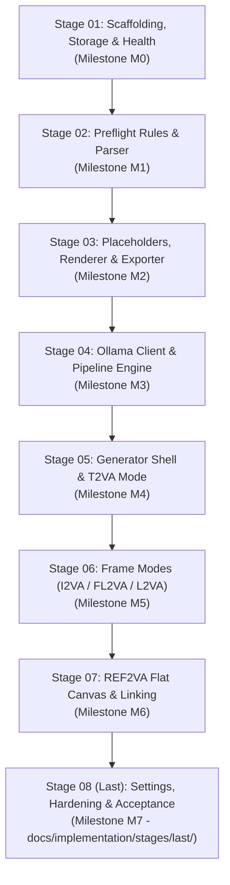

# H3 Prompt Studio — Implementation Stages Master Roadmap

This directory contains the complete, meticulously decomposed end-to-end development cycle for **H3 Prompt Studio**, derived strictly from the certified [`docs/specifications/specification-0.3.md`](file:///home/wizdroid/Applications/h3-mechanic/docs/specifications/specification-0.3.md).

The implementation is broken into **eight discrete, self-contained stages** designed to prevent over-engineering, guarantee architectural consistency, and enable seamless pausing and resuming at any checkpoint.

---

## 1. Stage Progression Graph

---

## 2. Traceability Matrix: Stages to Milestones & Acceptance Criteria

| Stage File | Milestone | Scope | Key Acceptance Criteria Verified |
|---|---|---|---|
| [`01-scaffolding-storage-health.md`](file:///home/wizdroid/Applications/h3-mechanic/docs/implementation/stages/01-scaffolding-storage-health.md) | **M0** | Core scaffolding, config, SQLite schema, migrations, security middleware, `/api/health`. | A-20, A-35, A-48, A-49 |
| [`02-preflight-rules-and-parser.md`](file:///home/wizdroid/Applications/h3-mechanic/docs/implementation/stages/02-preflight-rules-and-parser.md) | **M1** | Validation engine, prompt parser, estimators, PF-01 through PF-35, overrides. | A-08, A-10, A-11, A-12, A-27, A-34, A-41 |
| [`03-placeholders-renderer-exporter.md`](file:///home/wizdroid/Applications/h3-mechanic/docs/implementation/stages/03-placeholders-renderer-exporter.md) | **M2** | Placeholder protocol (`{{Lk}}`, `{{Tm}}`), deterministic renderer, atomic exporter, PLATES. | A-06, A-17, A-18, A-19, A-40, A-46 |
| [`04-ollama-client-and-pipeline.md`](file:///home/wizdroid/Applications/h3-mechanic/docs/implementation/stages/04-ollama-client-and-pipeline.md) | **M3** | Ollama client, structured JSON decoding, process lock, stage runner, fixer loop. | A-09, A-13, A-14, A-15, A-16, A-30, A-32, A-33, A-37 |
| [`05-t2va-module-and-shell.md`](file:///home/wizdroid/Applications/h3-mechanic/docs/implementation/stages/05-t2va-module-and-shell.md) | **M4** | Generator web shell, Nord styles, T2VA pipeline (`seed_elaboration` → `prose_writer`), fallback. | A-01, A-22, A-23, A-29 |
| [`06-frame-modes-i2va-fl2va-l2va.md`](file:///home/wizdroid/Applications/h3-mechanic/docs/implementation/stages/06-frame-modes-i2va-fl2va-l2va.md) | **M5** | Frame modes: I2VA, FL2VA, L2VA, instruction lines, single-shot FL2VA exception. | A-02, A-03, A-04, A-12 |
| [`07-ref2va-flat-canvas-module.md`](file:///home/wizdroid/Applications/h3-mechanic/docs/implementation/stages/07-ref2va-flat-canvas-module.md) | **M6** | REF2VA flat single-canvas, 0/1/multi-picture subject linking, shots, retention analysis. | A-05, A-24, A-38, A-39, A-42, A-43, A-45 |
| [`last/08-settings-hardening-and-final-acceptance.md`](file:///home/wizdroid/Applications/h3-mechanic/docs/implementation/stages/last/08-settings-hardening-and-final-acceptance.md) | **M7** | Settings module, theme switcher, voice library, safer framing, documentation, test suite sign-off. | A-21, A-25, A-26, A-28, A-31, A-36, A-44, A-47 |

---

## 3. Pause & Resume Protocol

If development must pause at any point, follow this strict protocol to maintain complete architectural continuity:

1. **Complete Current Step:** Finish the active step within the stage. Never pause mid-file or with failing migrations.
2. **Execute Stage Checkpoint:** Run the specific verification commands documented in the active stage file.
3. **Record Checkpoint State:** Fill out [`docs/implementation/stages/last/RESUME_CHECKPOINT.md`](file:///home/wizdroid/Applications/h3-mechanic/docs/implementation/stages/last/RESUME_CHECKPOINT.md) noting:
   - Current stage and step reached.
   - Status of automated test suite (`pytest tests/`).
   - Database migration version (`schema_version`).
   - Any outstanding context notes.
4. **Resuming:** When resuming, provide the new agent or developer with:
   - The contents of [`RESUME_CHECKPOINT.md`](file:///home/wizdroid/Applications/h3-mechanic/docs/implementation/stages/last/RESUME_CHECKPOINT.md).
   - The calibrated master prompt contained in the target stage markdown document.
